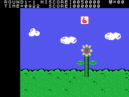
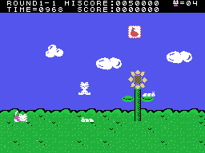
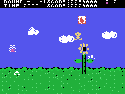

# Curiosities

## CAT in the balloons

At the end of each stage a balloon rises with a letter or a digit (the table at 0x8904, one per stage): 7, 5, 3, 2, 4
and **C** in the first town; 6, 1, 8, 0, 9 and **A** in the second; 3, 2, 7, 4, 6 and **T** in the third. The
balloons of the last stage of each town spell **CAT**.

## Two keys on the title

When the CASIO intro ends, the game looks at two keys once (0x8082):

- **SELECT** held: 0xE023 = 1, and what touches the kitten does not knock it down (`gatito_tocado`, 0x84D5). Falling
  off the bottom of the screen does: that death carries a 2 and does not look at SELECT. With the time at zero nothing
  happens either: TIME=OVER and it stays (read from the code). In openMSX, with SELECT, the pilot reached the third
  screen without losing a life.
- **ESC** held: 0xE039 = 2, and with no lives left CONTINUE PUSH TRIG1 / END PUSH TRIG2 appears: with button 1, four
  lives and the stage again, every time. In openMSX, one continue with four lives.

## STOP and F1

While playing, **STOP** stops the game (0xE1B7): the objects are saved, nothing moves and the kitten, drawn with other
sprites (0x5700), changes drawing every 16 frames without moving. **F1** knocks the kitten down and takes a life
(0xE1B3). Both checked in openMSX.

## The demo is played with drawings

Two of the three demos read their controls from 0x7FA0, which is **inside the tiles of the title's name** (0x7F9D):
the bytes of the drawing act as stick and buttons (0x815B). That is why the kitten in those demos dies at once.

## GAME START, unused

Among the scoreboard texts is GAME START (0x90EB), and no pointer reaches it. Whether anyone reads it has not been
measured.

## A screen inside the music

The last pointer of the screen table (0x41E2) points to 0xBF80, in the middle of the music pieces. Whether any stage
uses it has not been checked.

## Code nobody calls

- 0x8916: whether object IY is inside the screen.
- 0x8C7E and 0x8C97: pieces of copies to the VRAM.
- 0x9CAA: the start of `pantalla_objetos` again.
- 0x9976: a `ret` after another.

None of them ran in the coverage measured in openMSX.
