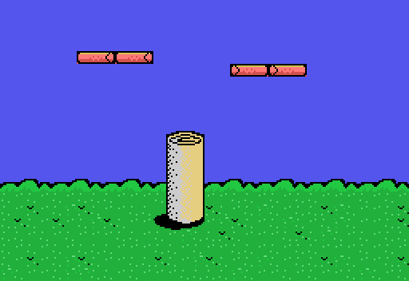
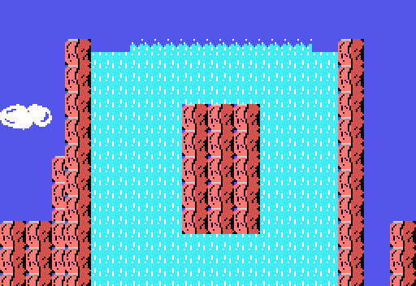

# Secrets and bugs

What was searched for in the code and what was found. A bug only goes here if it has been checked: by running the
game's own routine (`tools/bios.py`) or against the openMSX recordings.

## Secrets

- **SELECT and ESC on the title screen**: SELECT makes nothing knock the kitten down and ESC gives CONTINUE with four
  lives, every time. **STOP** pauses and **F1** takes a life. Checked in openMSX and told in
  [Curiosities](CURIOSITIES.html), like the balloons that spell **CAT**.
- Apart from those keys, the controls are read in the interrupt: the stick from the cursor keys and joystick 1, the
  two buttons of joystick 1, the space bar and GRAPH.

## Screens behind the goal

Each stage is a list of screens (0x4038), and the one in position 8 is the **goal house**: the stage ends on reaching
its door, at X 0x78 and height 0x88-0x8F (`fase_final_mira`, 0x8352). But the lists go on after the house, and
`pantalla_siguiente` (0x94D3), which moves to the screen on the right on reaching the edge, walks them all the same.
Running it here from the house on all eighteen stages:

| stage | to the right of the house |
|---|---|
| ROUND2-2 | a screen that appears nowhere else (0x66), the house again, and it ends |
| ROUND3-2 and ROUND3-6 | 0xFF: **back to the fifth screen of the stage**, and on to the house again |
| ROUND3-3 | another screen that appears nowhere else (0x67), the house again, and back to the fifth |
| the other fourteen | nothing: the kitten stays at the edge |

The two screens, built by running `escena_pon` (0x9B15) with the RAM and VRAM recorded on their stage:

The waterfall one is the one pointing to 0xBF80, among the music ([Curiosities](CURIOSITIES.html)). Getting to them
means crossing the door without going in, jumping over it at the right moment: that is read from the code, **it has
not been played**.

## Bug: past 9,999,990 points, the high score to zero

When the score goes past 999,999 inside (9,999,990 on screen, with the fixed 0), `puntos_suma` (0x8D5F) copies into the
high score the score **after it has wrapped** (0x8D8C). Running the game's addition here:

| score (on screen) | high score | + | after: score | high score |
|---|---|---|---|---|
| 123,450 | 100,000 | 100 | 123,550 | 123,550 |
| 9,999,900 | 9,999,900 | 100 | **0** | **0** |
| 9,999,500 | 9,999,500 | 900 | **400** | **400** |

## Bug: the cursor keys and the joystick at once

`palanca` (0x8F0D) joins the cursor keys and joystick 1 with an `or` (0x8F1D) of their direction numbers. With both at
once, running it here, right and down give **left** (7), and up-right and down-right give **down-left** (6).
