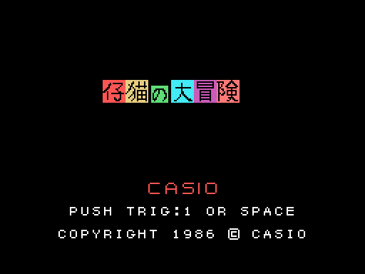
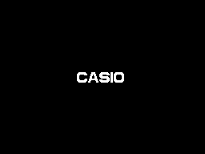
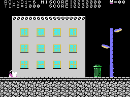
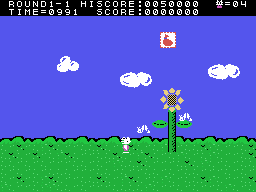
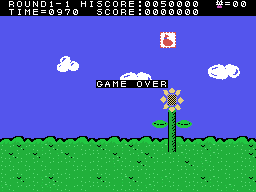

# The game

*Koneko no Daibouken* (仔猫の大冒険, "The kitten's great adventure") is a platform game seen from the side. A kitten
crosses three towns of six stages each, screen by screen and against the clock. All of that, in
[The stages](THE-STAGES.html).

Every GIF on this site is the ROM **running in openMSX** (a Japanese MSX1 with C-BIOS, at 60 frames per second): on
every frame the VRAM, the RAM and the VDP registers are logged, and `tools/vdp.py` paints them. The game ones come from
simple pilots written for the purpose (`tools/guiones/`).

## The intro and the title

Two CASIO logos come in from the sides and two more go down and up until they meet, with a short tune and SOFTWARE
below. On the title, the kitten crosses the screen from left to right and, as it goes, its name (チビちゃん) appears
letter by letter (`titulo`, 0x8073). When it reaches the other side, a **demo** starts: three in turn, on stages 1, 2
and 5.

## The controls

| | joystick | keyboard |
|---|---|---|
| walk, crouch | joystick 1 | the cursors |
| jump (higher the longer it is held) | button 1 | the space bar |
| throw what was picked up | button 2 | GRAPH |

The jump goes up while the button is held; when it is released, it stops going up (`salto`, 0x971B). With the stick
to one side it jumps diagonally. What is thrown has to be picked up first on the screen: one thing that goes
**straight** (+8 = 1) and another that goes **in an arc**, breaks obstacles and uncovers prizes (+8 = 2) (`tiro`,
0x9246).

## The time

TIME starts at 1000 and goes down one unit every 8 frames in the first town, 7 in the second and 6 in the third
(`tiempo`, 0x8991); below 100 a warning sounds. At zero, TIME=OVER and the kitten falls. What is left at the end of the
stage is paid: 10 points per unit.

## The lives

The game starts with **five kittens**, four in reserve. An enemy or what it drops knocks it down, and so does falling
off the bottom of the screen; the stage starts again from its checkpoint (`gatito_cae`, 0x84E9). If it carries a
**balloon**, the hit only takes the balloon. One more life at 50,000 points and another every 100,000. With no lives
left, GAME OVER.

## The points

The scoreboard puts **a fixed 0** after the six digits; the figures on this site are the ones on screen.

| | points |
|---|---:|
| type 0 or 1 (with what is thrown in an arc) | 50 |
| types 2, 5 and 6 | 100 |
| type 7 (the flying one) | 300 |
| type 4 (only with what is thrown straight) | 500 |
| a prize | 100, 500, 1,000 or 2,000 |
| a broken obstacle | 400 or 600 |
| the time left | 10 per unit |

The high score starts at 0050000.
