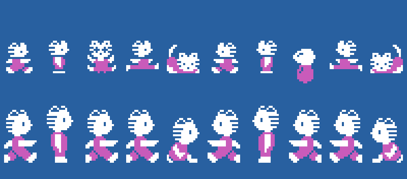
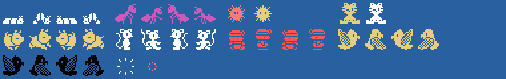
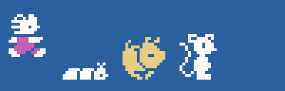

# The sprites

Everything on this page is **put together from the ROM tables** with `tools/hojas.py`. The drawings are the 0x800
bytes at 0x5800 that `sprites_dibujos` (0x8CD4) puts at 0x3800, and depending on the scene (0xE04A) it changes some
of them: except in scene 5, 0x40 bytes from 0x57A0 to drawing 0x4C and from 0x56C0 to 0xCC; in scene 4, also 0x6F30
to 0x68 and 0x6F70 to 0xE8. So the same number is a different creature in each scene. None of these images is a
screenshot.

**Checked against openMSX** on the recordings of this site:

- the sprite drawing table built here for the scene of each frame (VRAM 0x3800-0x3FFF) is **identical** to the
  game's on 88,636 frames; 500 more have the pause drawings (0x5700) and 170 catch a copy halfway or the drawings of
  the scene before; **7 unexplained**;
- the kitten's sprites (0xE300, 0xE310 and 0xE320) match on 61,070 frames, and hit (blinking and shaking) on 4,475;
  **20 unexplained**;
- the creatures (0xE380, 16 bytes) have the drawing and colour of their type on **150,573 frames, 0 different**
  (151 more are just coming out and 186 blowing up).

## The kitten

Two sprites, the drawing (+0x1C) in white and the drawing + 4 in magenta 8 dots lower (`gatito_dibujo`, 0x9907;
the colours from `fase`, 0x821B): standing and walking 0x00 and 0x08 (the step is bit 2 of its X, 0x959C), hit
0x10 (0x8545), jumping sideways 0x18 (0x98A6) and crouching 0x20, + 0x80 facing left. Carrying something on its
head (`gatito_lleva`, 0x9933) it is drawn bigger: the head with its paws up (0x34 standing, 0x28 walking, 0x40
crouching, in white) 16 dots above, and that drawing + 4 and + 8 in the same place. Top row, facing right and left;
below, carrying:

## The creatures

One sprite each (0xE380, +4 the type), with the drawing and the drawing + 4 as they walk, and + 0x80 the other way.
First row: types 0 and 1 (`andarin`, 0xA0E5: 0x68 in white; in scene 4 that number is another drawing and goes in
magenta; it comes out with 0x78), type 2 (`aparece`: 0xF0, blinking light red and light yellow) and type 3 (`regalo`:
0xE4, blinking light yellow and white). Second row: type 4 (`andarin_alto`: 0x5C, light yellow), type 5 (`saltarin`:
0x54, white), type 6 (`paseante`: 0x4C as it is in scene 5, red) and type 7 (`volador`: 0x4C with the drawing of
the other scenes, light yellow, and sometimes black from the second round). Last, the explosion (0xF8 and 0xFC, `explosion`):

The kitten walking both ways and some creatures walking, at the game's pace:

