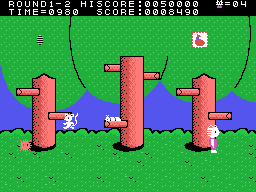
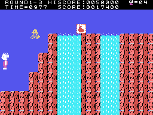
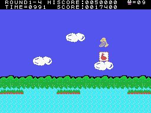
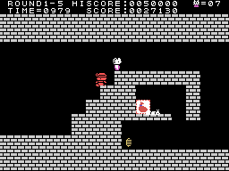
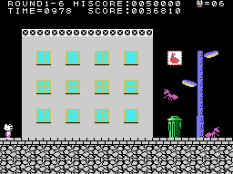
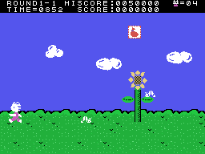
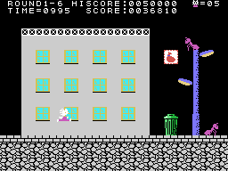
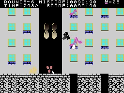
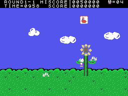

# The stages

Three **towns** (0xE009): PEACH, APPLE and LEMON, of **six stages** each: ROUND1-1 to ROUND3-6 on the scoreboard. Each
stage has its scene (the table at 0x840D): the meadow, the forest, the waterfalls, the lake, the bricks and the city.
After the sixth stage of a town, CLEAR ... TOWN appears and, before the next one, GO TO and the new town. After the
eighteenth, the ending: GREAT!! and I LOVE YOU with two kittens and a heart, and the first town again (`final`,
0x8843).

A stage is several **fixed screens** (the table at 0x4038; 104 screens in the ROM): at the right edge, the screen
scrolls 32 columns and the next one comes in (`pantalla_cambia`, 0x9977). There is no going back. The stage ends on
the last screen, at a fixed spot.

What was recorded comes from a normal game, another with SELECT held on the title and a **forced** one: with SELECT,
each stage is played for 1,500 frames and is set as over with a poke to 0xE186; since SELECT does not prevent falls
off the bottom, when fewer than three lives are left they are set to nine. That way the eighteen stages and the ending
are gone through.

## The balloon at the end of a stage

When a stage ends, a balloon rises in column 17, with a letter or a digit of the stage on it (0x8904). Then the time
is paid (`fase_acabada`, 0x8639).

## The objects

Each screen brings its objects (the table at 0xB000): what is thrown straight or in an arc; **prizes** of 100 to 2,000
points, some hidden until what is thrown in an arc hits them, and one that also gives a life; and **obstacles** that
knock the kitten down if it touches them and break with four arc throws (`premio`, 0x9E7C; `obstaculo`, 0x9F88).

## The enemies

| type | what it is |
|---:|---|
| 0, 1 | walks on the ground and turns at the edges; only what is thrown in an arc defeats it |
| 2 | appears flashing and goes towards the kitten |
| 3 | a **balloon** that appears and disappears: taken, the kitten carries it and the next hit only takes the balloon |
| 4 | walks on the platforms; only what is thrown straight defeats it |
| 5 | jumps |
| 6 | strolls and turns at random |
| 7 | flies sideways, getting closer to the kitten's height; from the second town, some drop type 8 |
| 8 | what 7 drops: it falls |

