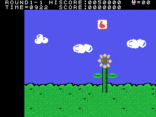
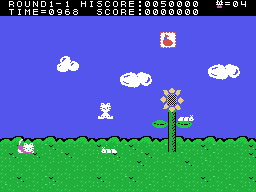
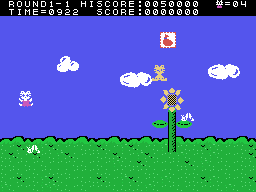

# Curiosidades

## CAT en los globos

Al final de cada fase sube un globo con una letra o una cifra (la tabla de 0x8904, una por fase): 7, 5, 3, 2, 4 y
**C** en el primer pueblo; 6, 1, 8, 0, 9 y **A** en el segundo; 3, 2, 7, 4, 6 y **T** en el tercero. Los globos de la
última fase de cada pueblo dicen **CAT**.

## Dos teclas en el título

Al acabar la presentación de CASIO, el juego mira dos teclas una vez (0x8082):

- **SELECT** pulsada: 0xE023 = 1, y lo que toca al gatito no lo tumba (`gatito_tocado`, 0x84D5). Caer por abajo de la
  pantalla sí: esa muerte lleva un 2 y no mira SELECT. Con el tiempo a cero tampoco pasa nada: TIME=OVER y se queda (leído en el código).
  En openMSX, con SELECT, el piloto llegó a la tercera pantalla sin perder vidas.
- **ESC** pulsada: 0xE039 = 2, y sin vidas sale CONTINUE PUSH TRIG1 / END PUSH TRIG2: con el botón 1, cuatro vidas y
  la fase otra vez, todas las veces. En openMSX, una continuación con cuatro vidas.

## STOP y F1

Jugando, **STOP** para el juego (0xE1B7): los objetos se guardan, nada se mueve y el gatito, dibujado con otros
sprites (0x5700), cambia de dibujo cada 16 cuadros sin moverse. **F1** tumba al gatito y quita una vida (0xE1B3). Las dos, comprobadas en openMSX.

## La demostración se juega con dibujos

Dos de las tres demostraciones leen sus mandos de 0x7FA0, que está **dentro de las casillas del nombre del título**
(0x7F9D): los bytes del dibujo hacen de palanca y botones (0x815B). Por eso el gatito de esas demostraciones muere
enseguida.

## GAME START, sin usar

Entre los textos del marcador está GAME START (0x90EB), y ningún puntero llega a él. Si alguien lo lee no se ha medido.

## Una pantalla dentro de la música

El último puntero de la tabla de las pantallas (0x41E2) apunta a 0xBF80, en medio de las piezas de la música. La usa la ronda
3-3, detrás de la meta: está en [Secretos y fallos](SECRETOS-Y-FALLOS.html).

## Código que nadie llama

- 0x8916: si el objeto IY está dentro de la pantalla.
- 0x8C7E y 0x8C97: trozos de copia a la VRAM.
- 0x9CAA: el principio de `pantalla_objetos` otra vez.
- 0x9976: un `ret` detrás de otro.

Ninguno se ejecutó en la cobertura medida en openMSX.
