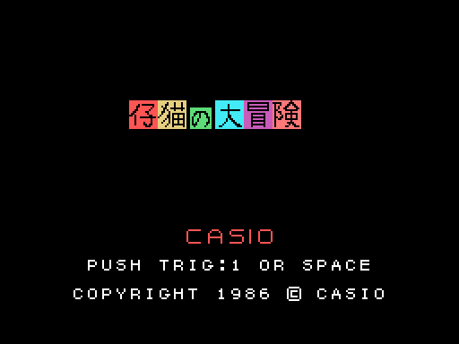
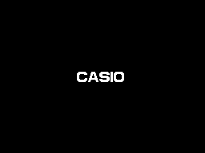
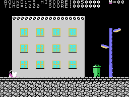
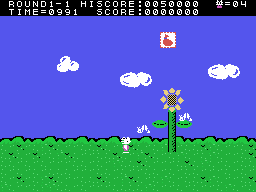
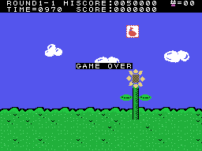

# La partida

*Koneko no Daibouken* (仔猫の大冒険, "La gran aventura del gatito") es un juego de plataformas visto de lado. Un gatito
cruza tres pueblos de seis fases cada uno, pantalla a pantalla y contra el reloj. Todo eso, en
[Las fases](LAS-FASES.html).

Todos los GIF de esta web son la ROM **funcionando en openMSX** (un MSX1 japonés con C-BIOS, a 60 cuadros por
segundo): en cada cuadro se apuntan la VRAM, la RAM y los registros del VDP, y `tools/vdp.py` los pinta. Los de la
partida son pilotos sencillos escritos para ello (`tools/guiones/`).

## La presentación y el título

Dos CASIO entran por los lados y otros dos bajan y suben hasta juntarse, con una música corta y SOFTWARE debajo. En
el título, el gatito cruza la pantalla de izquierda a derecha y, a su paso, aparece su nombre (チビちゃん) letra a
letra (`titulo`, 0x8073). Cuando llega al otro lado empieza una **demostración**: tres por turno, en las fases 1, 2 y
5.

## Los mandos

| | mando | teclado |
|---|---|---|
| andar, agacharse | el mando 1 | los cursores |
| saltar (más alto cuanto más rato se pulsa) | el botón 1 | la barra |
| tirar lo cogido | el botón 2 | GRAPH |

El salto sube mientras se tenga pulsado el botón; al soltarlo, deja de subir (`salto`, 0x971B). Con la palanca a un
lado salta en diagonal. Lo que se tira hay que cogerlo antes en la pantalla: una cosa que va **recta** (+8 = 1) u
otra que va **en arco** y rompe obstáculos y descubre premios (+8 = 2) (`tiro`, 0x9246).

## El tiempo

TIME empieza en 1000 y baja una unidad cada 8 cuadros en el primer pueblo, 7 en el segundo y 6 en el tercero (`tiempo`, 0x8991); por debajo de 100 suena un aviso. A cero, TIME=OVER y el gatito cae. Lo que queda al
acabar la fase se cobra: 10 puntos por unidad.

## Las vidas

La partida empieza con **cinco gatitos**, cuatro de reserva. Un enemigo o lo que suelta lo tumba, y caer por abajo
de la pantalla, también; la fase vuelve a empezar desde su punto de control (`gatito_cae`, 0x84E9). Si lleva un
**globo** encima, el golpe solo le quita el globo. Una vida más a los 50.000 puntos y otra cada 100.000. Sin vidas,
GAME OVER.

## Los puntos

El marcador pone **un 0 fijo** detrás de las seis cifras; las cifras de esta web son las de la pantalla.

| | puntos |
|---|---:|
| el tipo 0 o 1 (con lo que se tira en arco) | 50 |
| los tipos 2, 5 y 6 | 100 |
| el tipo 7 (el que vuela) | 300 |
| el tipo 4 (solo con lo que se tira recto) | 500 |
| un premio | 100, 500, 1.000 o 2.000 |
| un obstáculo roto | 400 o 600 |
| el tiempo que queda | 10 por unidad |

El récord empieza en 0050000.
