# Las fases

Tres **pueblos** (0xE009): PEACH, APPLE y LEMON, de **seis fases** cada uno: ROUND1-1 a ROUND3-6 en el marcador. Cada
fase tiene su escena (la tabla de 0x840D): el prado, el bosque, las cascadas, el lago, los ladrillos y la ciudad. Al
acabar la sexta fase de un pueblo sale CLEAR ... TOWN y, antes de la siguiente, GO TO y el pueblo nuevo. Después de
la decimoctava, el final: GREAT!! e I LOVE YOU con dos gatitos y un corazón, y otra vez el primer pueblo (`final`,
0x8843).

Una fase son varias **pantallas fijas** (la tabla de 0x4038; 104 pantallas en la ROM): al llegar al borde derecho, la
pantalla corre 32 columnas y entra la siguiente (`pantalla_cambia`, 0x9977). No se puede volver atrás. La fase acaba
en la última pantalla, en un sitio fijo.

Lo grabado sale de una partida normal, otra con SELECT pulsada en el título y otra **forzada**: con SELECT, cada fase
se juega 1.500 cuadros y se da por acabada con un poke a 0xE186; como SELECT no evita las caídas por abajo, cuando
quedan menos de tres vidas se ponen nueve. Así se recorren las dieciocho fases y el final.

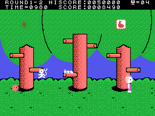

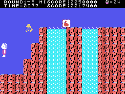

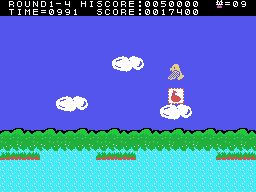

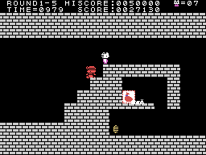

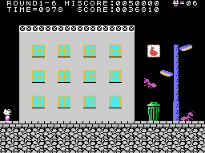

## Los mapas

Las dieciocho fases, cada una con sus pantallas en el orden de su lista (0x4038), de izquierda a derecha y a la mitad
de tamaño. Están **pintadas ejecutando la ROM**: cada pantalla la monta `escena_pon` (0x9B15) con la RAM y la VRAM
grabadas en su fase, que traen los dibujos y colores de su escena (`tools/mapas.py`). Van sin marcador, sin sprites
y sin los objetos, que el juego pinta después. La última de cada fila es la casita de la meta, y en 2-2 y 3-3 siguen
las pantallas escondidas de [Secretos y fallos](SECRETOS-Y-FALLOS.html).

Cotejo: las 27 pantallas por las que pasa la grabación forzada salen como la tabla de nombres grabada, salvo entre 4 y
57 casillas de 704 en cada una: los objetos y el agua o lo que se anima, que el juego pinta encima.

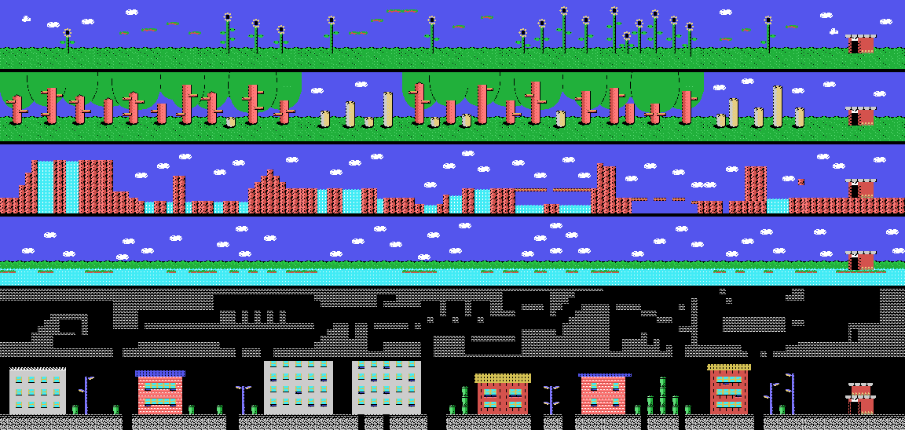

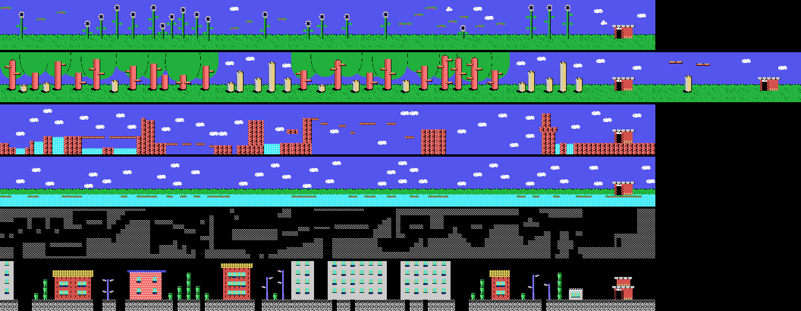

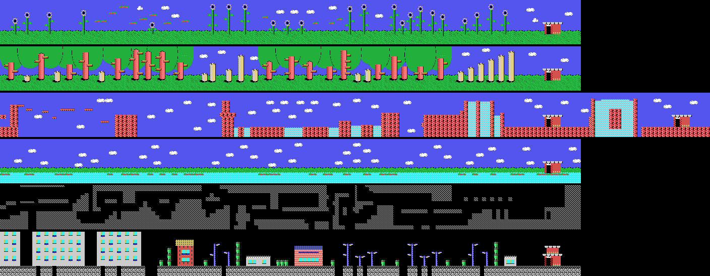

## El globo del final de fase

Al acabar una fase, en la columna 17 sube un globo, y en él, una letra o una cifra de la fase (0x8904). Después se
cobra el tiempo (`fase_acabada`, 0x8639).

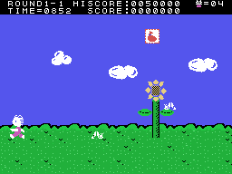

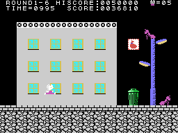

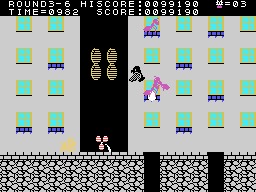

## Los objetos

Cada pantalla trae sus objetos (la tabla de 0xB000): lo que se tira recto o en arco; **premios** de 100 a 2.000
puntos, algunos escondidos hasta que les da lo que se tira en arco, y uno que además da una vida; y **obstáculos**
que tumban al gatito si los toca y que se rompen con cuatro tiros en arco (`premio`, 0x9E7C; `obstaculo`, 0x9F88).

## Los enemigos

| tipo | qué es |
|---:|---|
| 0, 1 | anda por el suelo y da la vuelta en los bordes; solo lo derrota lo que se tira en arco |
| 2 | aparece parpadeando y va hacia el gatito |
| 3 | un **globo** que aparece y desaparece: cogido, el gatito lo lleva encima y el siguiente golpe solo le quita el globo |
| 4 | anda por las plataformas; solo lo derrota lo que se tira recto |
| 5 | salta |
| 6 | pasea y da la vuelta al azar |
| 7 | vuela de lado acercándose a la altura del gatito; desde el segundo pueblo, algunos sueltan el tipo 8 |
| 8 | lo que suelta el 7: cae |

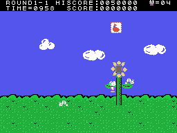
