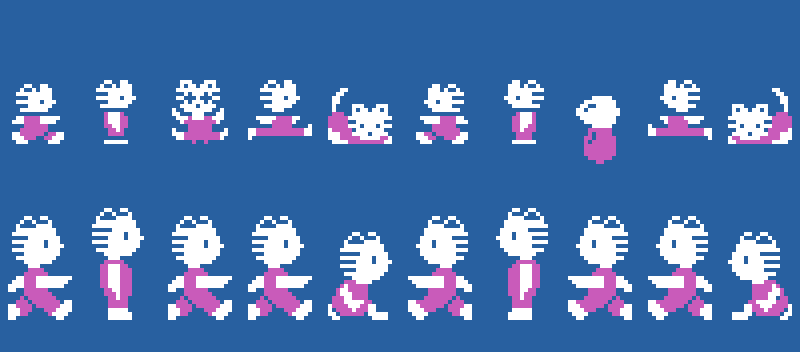
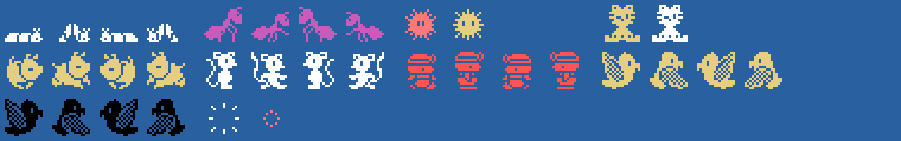
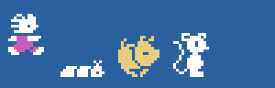

# Los sprites

Todo lo de esta página está **montado desde las tablas de la ROM** con `tools/hojas.py`. Los dibujos son los 0x800
bytes de 0x5800 que `sprites_dibujos` (0x8CD4) pone en 0x3800, y según la escena (0xE04A) cambia algunos: salvo en
la escena 5, 0x40 bytes de 0x57A0 al dibujo 0x4C y de 0x56C0 al 0xCC; en la escena 4, además, 0x6F30 al 0x68 y
0x6F70 al 0xE8. Así un mismo número es un bicho distinto en cada escena. Ninguna de estas imágenes es una captura.

**Cotejado con openMSX** en las grabaciones de esta web:

- la tabla de dibujos de los sprites montada aquí para la escena de cada cuadro (VRAM 0x3800-0x3FFF) es
  **idéntica** a la del juego en 88.636 cuadros; otros 500 tienen los dibujos de la pausa (0x5700) y 170 pillan una
  copia a medias o los dibujos de la escena de antes; **7 sin explicar**;
- los sprites del gatito (0xE300, 0xE310 y 0xE320) casan en 61.070 cuadros, y tocado (parpadeando y temblando) en
  4.475; **20 sin explicar**;
- los bichos (0xE380, 16 bytes) llevan el dibujo y el color de su tipo en **150.573 cuadros, 0 distintos** (otros
  151 están saliendo y 186 estallando).

## El gatito

Dos sprites, el dibujo (+0x1C) en blanco y el dibujo + 4 en magenta 8 puntos más abajo (`gatito_dibujo`, 0x9907;
los colores, de `fase`, 0x821B): de pie y andando 0x00 y 0x08 (el paso es el bit 2 de su X, 0x959C), tocado 0x10
(0x8545), saltando de lado 0x18 (0x98A6) y agachado 0x20, + 0x80 mirando a la izquierda. Llevando algo en la cabeza
(`gatito_lleva`, 0x9933) se dibuja más grande: la cabeza con las patas arriba (0x34 de pie, 0x28 andando, 0x40
agachado, en blanco) 16 puntos por encima, y ese dibujo + 4 y + 8 en el mismo sitio. Arriba, mirando a la derecha y a
la izquierda; abajo, llevando algo:

## Los bichos

Un sprite cada uno (0xE380, +4 el tipo), con el dibujo y el dibujo + 4 al andar, y + 0x80 hacia el otro lado. En la
primera fila: los tipos 0 y 1 (`andarin`, 0xA0E5: 0x68 en blanco; en la escena 4 ese número es otro dibujo y va en
magenta; sale con el 0x78), el tipo 2 (`aparece`: 0xF0, parpadeando en rojo claro y amarillo claro) y el tipo 3
(`regalo`: 0xE4, parpadeando en amarillo claro y blanco). En la segunda: el tipo 4 (`andarin_alto`: 0x5C, amarillo
claro), el 5 (`saltarin`: 0x54, blanco), el 6 (`paseante`: 0x4C tal como es en la escena 5, rojo) y el 7 (`volador`:
0x4C con el dibujo de las otras escenas, amarillo claro, y a veces negro desde la segunda vuelta). Al final, la explosión
(0xF8 y 0xFC, `explosion`):

El gatito andando a los dos lados y algunos bichos andando, al ritmo del juego:

