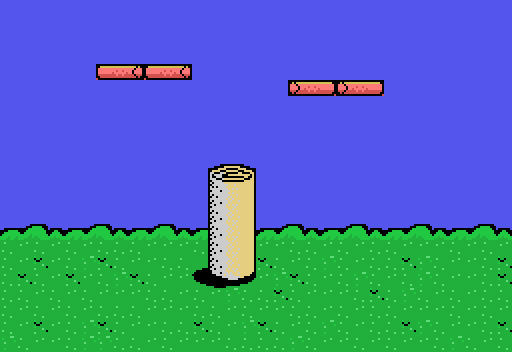
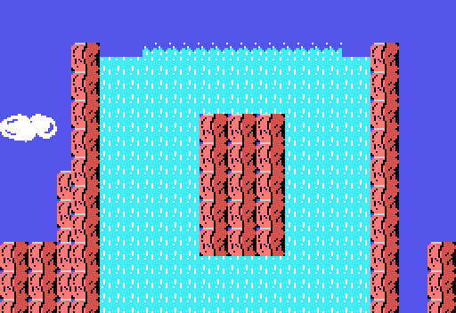
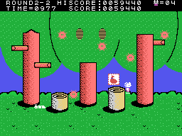
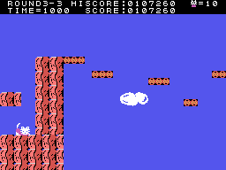

# Secretos y fallos

Lo que se ha buscado en el código y lo que se ha encontrado. Un fallo solo entra aquí si está comprobado:
ejecutando la propia rutina del juego (`tools/bios.py`) o contra las grabaciones de openMSX.

## Secretos

- **SELECT y ESC en el título**: SELECT hace que nada tumbe al gatito y ESC da CONTINUE con cuatro vidas, todas las
  veces. **STOP** para el juego y **F1** quita una vida. Comprobados en openMSX y contados en
  [Curiosidades](CURIOSIDADES.html), igual que los globos que dicen **CAT**.
- Fuera de esas teclas, los mandos se leen en la interrupción: la palanca de los cursores y del mando 1, los dos
  botones del mando 1, la barra y GRAPH.

## Pantallas detrás de la meta

Cada fase es una lista de pantallas (0x4038), y la de la posición 8 es la **casita de la meta**: la fase acaba al
llegar a su puerta, en la X 0x78 y a la altura 0x88-0x8F (`fase_final_mira`, 0x8352). Pero las listas siguen después
de la casita, y `pantalla_siguiente` (0x94D3), la que pasa a la pantalla de la derecha al llegar al borde, las
recorre igual. Ejecutándola aquí desde la casita en las dieciocho fases:

| fase | a la derecha de la casita |
|---|---|
| ROUND2-2 | una pantalla que no sale en ningún otro sitio (la 0x66), otra vez la casita, y se acaba |
| ROUND3-2 y ROUND3-6 | 0xFF: **vuelta a la quinta pantalla de la fase**, y otra vez hasta la casita |
| ROUND3-3 | otra pantalla que no sale en ningún otro sitio (la 0x67), otra vez la casita, y vuelta a la quinta |
| las otras catorce | nada: el gatito se queda en el borde |

Las dos pantallas, montadas ejecutando `escena_pon` (0x9B15) con la RAM y la VRAM grabadas en su fase:

La de la cascada es la que apunta a 0xBF80, entre la música ([Curiosidades](CURIOSIDADES.html)). Para llegar a ellas
jugando hay que cruzar la puerta sin entrar, saltando por encima en el momento justo: eso está leído en el código.

**Forzadas en openMSX** (`tools/guiones/escondidas.tcl`): con SELECT, un gancho en `pantalla_siguiente` pone la
posición en la de la casita la primera vez que el gatito llega al borde derecho de 2-2 y de 3-3, y el juego hace lo
demás: sube a la posición 9 y entra la pantalla escondida con su scroll, sus objetos y sus enemigos. En 3-3, además,
el piloto no llegaba solo al borde y al gatito se le pone en la X 0xF0. La tabla de nombres grabada casa con la
montada ejecutando `escena_pon`: en 2-2, las 704 casillas; en 3-3 cambian 28, las del objeto de la derecha y el agua,
que el juego pinta después.

## Fallo: pasados los 9.999.990 puntos, el récord a cero

Cuando los puntos pasan de 999.999 por dentro (9.999.990 en pantalla, con el 0 fijo), `puntos_suma` (0x8D5F) copia al
récord los puntos **después de dar la vuelta** (0x8D8C). Ejecutando aquí la suma del juego:

| puntos (en pantalla) | récord | + | después: puntos | récord |
|---|---|---|---|---|
| 123.450 | 100.000 | 100 | 123.550 | 123.550 |
| 9.999.900 | 9.999.900 | 100 | **0** | **0** |
| 9.999.500 | 9.999.500 | 900 | **400** | **400** |

## Fallo: los cursores y el mando a la vez

`palanca` (0x8F0D) junta los cursores y el mando 1 con un `or` (0x8F1D) de sus números de dirección. Con los dos a la
vez, ejecutándolo aquí, derecha y abajo dan **izquierda** (7), y arriba-derecha y abajo-derecha, **abajo-izquierda**
(6).
